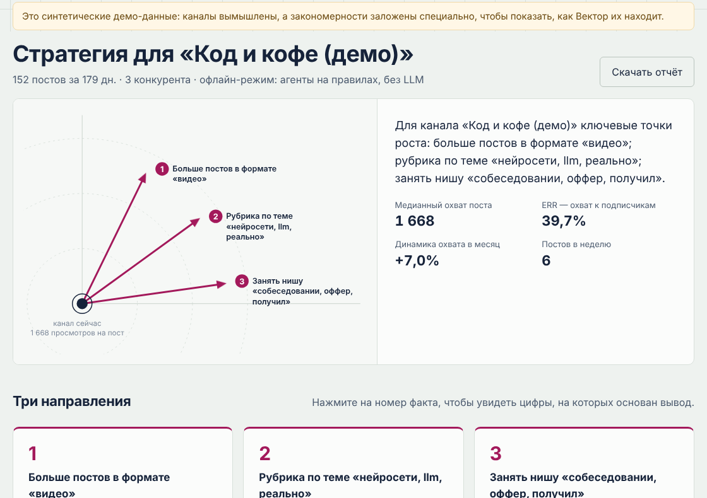
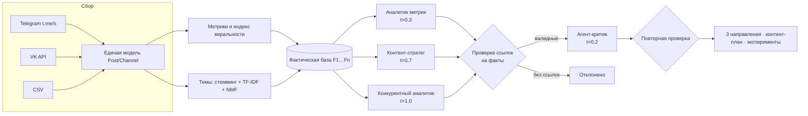
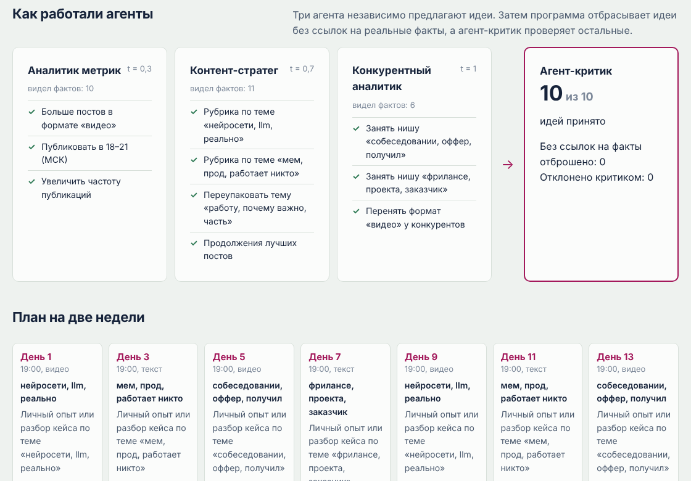
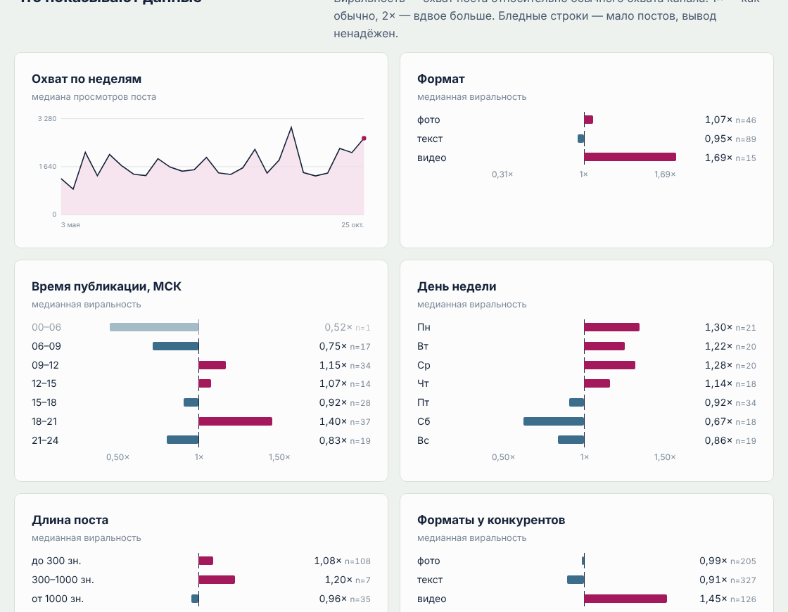

# Вектор — мультиагентный ИИ-стратег для авторов контента

**Вектор** анализирует Telegram-канал или сообщество VK автора и его конкурентов, вычисляет, что на самом деле влияет на охват, и с помощью команды ИИ-агентов формирует стратегию: три направления развития, контент-план на две недели и эксперименты.

Главная особенность — **защита от «галлюцинаций» LLM**. Каждый вывод аналитики превращается в пронумерованный факт (F1, F2, …). Агенты обязаны ссылаться на факты, программный фильтр отбрасывает идеи без ссылок или со ссылками на несуществующие факты, а **агент-критик** проверяет, подтверждают ли цифры каждую рекомендацию.

**Демо:** `https://rustsay.github.io/vektor/` — статическая версия на синтетических данных (см. «Публикация демо»).



## Что умеет

- **Сбор данных:** публичные Telegram-каналы (через веб-превью `t.me/s`, без токенов), стены VK (официальный API), CSV с любой площадки (YouTube, Дзен, Instagram и др.; колонки распознаются по синонимам на русском и английском).
- **Метрики:** медианный охват, ERR, ER, динамика охвата, ритм публикаций.
- **Индекс виральности:** охват поста делится на медиану 15 предыдущих постов того же канала. Это позволяет честно сравнивать посты растущего канала и каналы разного размера. Свежие посты (< 72 ч) и закреплённые исключаются.
- **Влияние факторов:** формат, время (МСК), день недели, длина. Значимость проверяется тестом Манна–Уитни, каждому выводу присваивается уровень уверенности.
- **Динамика:** робастная регрессия Тейла–Сена с 90%-доверительным интервалом (устойчива к единичным «залетевшим» постам).
- **Тематическое моделирование:** TF-IDF по стеммированному тексту (собственная реализация стеммера Snowball для русского языка) + NMF. Шаблонные подписи («Подписывайтесь…») удаляются автоматически.
- **Конкурентный анализ:** сравнительная таблица и поиск «свободных ниш» — тем, которые хорошо заходят у конкурентов, но отсутствуют у автора. Посты конкурентов собираются за тот же период, что и посты автора (до 1000 постов), а если конкурент несопоставим по размеру (в 15 раз и более) или его период собран не полностью, Вектор об этом предупреждает.
- **Мультиагентная стратегия** и отчёт в Markdown.

## Архитектура



Агенты работают параллельно с разной температурой генерации: от строгого аналитика (0,3) до смелого генератора идей (1,0). Критик работает как редакционный совет: принимает или отклоняет каждую идею с объяснением причины. Если LLM недоступна или вернула ошибку, соответствующий агент автоматически переключается на правила, и конвейер не падает.



## Валидация

Корректность аналитики проверяется на синтетических данных с заранее заложенными закономерностями (`vektor/demo.py`). На 8 независимых случайных наборах:

| Заложенный эффект | Найден |
|---|---|
| Видео заходит лучше других форматов | 8 из 8 |
| Лучший слот публикации — 18–21 МСК | ≥ 6 из 8 |
| У конкурентов есть свободная ниша «собеседования» | ≥ 7 из 8 |

Эти проверки входят в автотесты (`tests/test_analytics.py`). Сбор данных дополнительно проверен на реальном публичном Telegram-канале. Отдельные тесты проверяют, что выдуманные LLM ссылки на факты (например, `F99`) отбрасываются, а при отказе модели срабатывает резервный режим.



## Запуск

### Локально

```bash
python -m venv .venv && source .venv/bin/activate   # Windows: .venv\Scripts\activate
pip install -r requirements.txt
python -m vektor
```

Откройте http://localhost:8000 и нажмите «Посмотреть на демо-данных» или укажите свой канал.

### Docker

```bash
cp .env.example .env     # при необходимости заполните LLM и VK
docker compose up --build
```

### Подключение LLM

Без настроек агенты работают в **офлайн-режиме** (на правилах). Для LLM-режима подойдёт любая OpenAI-совместимая модель — задайте переменные окружения:

| Вариант | `VEKTOR_LLM_BASE_URL` | `VEKTOR_LLM_MODEL` |
|---|---|---|
| Ollama (локально) | `http://localhost:11434/v1` | например, `qwen2.5:14b` |
| vLLM / LM Studio | адрес вашего сервера + `/v1` | имя загруженной модели |
| Облачный провайдер с OpenAI-совместимым API | URL из документации провайдера | имя модели |

`VEKTOR_LLM_API_KEY` — ключ провайдера (для локальных моделей можно указать любую строку).

Дополнительные настройки (необязательно):

| Переменная | По умолчанию | Зачем |
|---|---|---|
| `VEKTOR_LLM_TIMEOUT` | `300` | сколько секунд ждать ответа модели |
| `VEKTOR_LLM_NUM_CTX` | `8192` | окно контекста для Ollama. Стандартного окна Ollama (2–4 тыс. токенов) не хватает для промпта: он обрезается, и модель отвечает невпопад. Поэтому для адресов с портом `11434` Вектор сам использует родной API Ollama (`/api/chat`) с увеличенным окном и строгим JSON-форматом |
| `VEKTOR_LLM_PARALLEL` | `1` для локальных моделей, `3` для облачных | сколько агентов опрашивать одновременно |
| `VEKTOR_LLM_JSON_MODE` | `1` | просить модель отвечать строго в JSON |

Если модель не ответила или вернула неразборчивый ответ, этот шаг выполняется на правилах. В интерфейсе и отчёте честно указано, сколько шагов из четырёх выполнила LLM, а причина ошибки выводится в терминал.

### VK

Для сообществ VK нужен сервисный ключ приложения: vk.com/apps?act=manage → создать приложение → «Сервисный ключ доступа». Укажите его в `VK_SERVICE_TOKEN` или в поле интерфейса.

### Формат CSV

Минимум — дата и просмотры. Пример: `examples/example_channel.csv`.

```
date,text,views,likes,comments,reposts,type
2026-10-01 18:00,Текст поста,1200,35,4,2,video
```

Время без часового пояса считается московским.

## Тесты

```bash
python -m unittest discover -s tests -t .
```

34 теста: парсер Telegram (на HTML-фикстуре), VK (на имитации API с пагинацией), CSV, стеммер, обнаружение заложенных эффектов, конвейер агентов с имитацией «галлюцинирующей» LLM, частичные отказы модели, HTTP-клиент (OpenAI-совместимый и Ollama), веб-API.

## Публикация демо

```bash
python scripts/build_static_demo.py   # → docs/index.html
```

В настройках репозитория на GitHub: Settings → Pages → Deploy from branch → `main` / `docs`.

## API

| Метод | Путь | Назначение |
|---|---|---|
| `POST` | `/api/jobs` | запустить анализ: `{"author": {"platform": "telegram", "id": "@channel"}, "competitors": [...], "max_posts": 200}` или `{"demo": true}` |
| `GET` | `/api/jobs/<id>` | статус, шаги и результат |
| `GET` | `/api/jobs/<id>/report.md` | отчёт в Markdown |
| `POST` | `/api/upload` | загрузить CSV (multipart: `file`, `name`, `subscribers`) |
| `GET` | `/api/config` | режим LLM и наличие ключа VK |

## Ограничения

- Веб-превью Telegram не показывает комментарии и репосты, поэтому для Telegram вовлечённость считается только по реакциям.
- Парсер `t.me/s` опирается на текущую вёрстку Telegram и может потребовать обновления, если она изменится.
- Статистика по группам с малым числом постов ненадёжна: такие выводы помечаются низкой уверенностью и уходят в эксперименты, а не в рекомендации.
- Корреляция ≠ причинность: рекомендации — это гипотезы, подкреплённые данными. Поэтому в стратегии есть блок экспериментов.
- Выбирайте конкурентов сопоставимого размера и тематики: сравнение личного блога с крупным новостным каналом даст ложные «ниши».
- Тренд считается по постам старше 7 дней, но в Telegram посты продолжают медленно набирать просмотры, поэтому реальный тренд может быть немного лучше оценки.
- Используются только публичные данные.

## Дальнейшее развитие

- Агент-редактор, который даёт темам человеческие названия.
- Подключение YouTube Data API.
- Еженедельный мониторинг: отчёт об изменениях и проверка результатов экспериментов.
- Бот в Telegram для получения отчёта прямо в мессенджере.

## Структура

```
vektor/
  connectors/   сбор данных: telegram.py, vk.py, csv_import.py
  analytics/    stemmer.py, metrics.py, topics.py, facts.py, engine.py
  agents/       llm.py (OpenAI-совместимый клиент), prompts.py, pipeline.py
  static/       интерфейс: index.html, style.css, app.js (без фреймворков)
  app.py        Flask: REST API и фоновые задачи
  report.py     отчёт в Markdown
  demo.py       генератор синтетических данных
tests/          автотесты и заглушка LLM
scripts/        сборка статического демо
```

## Автор

Сайфуллин Рустам Амирович — Институт искусственного интеллекта, робототехники и системной инженерии КФУ.

Архитектура «агенты + агент-судья» развивает подход из моего проекта «Эверест» (мультиагентная проверка заданий ЕГЭ). Разработка велась с использованием генеративного ИИ как ассистента программиста.

Лицензия: MIT.
